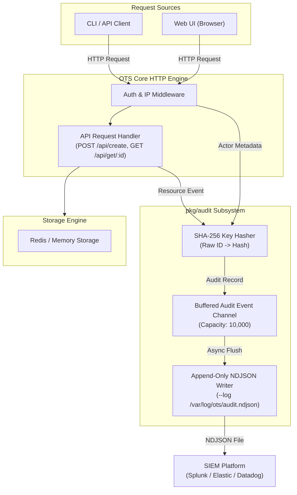

# OTS Enterprise NDJSON Audit Logging Specification (AUDIT.md)

**Document Version:** 1.0.0  
**Target Audience:** Security Engineers, Compliance Officers, System Administrators, SIEM Operators  
**Status:** Approved Architectural Specification  
**System:** OTS (One-Time Secret Engine)  

---

## 1. Architectural Vision & Compliance Objectives

The OTS Audit Logging Subsystem provides an append-only, high-throughput, structured **NDJSON (Newline Delimited JSON)** event pipeline. Designed for enterprise compliance standards (SOC 2, ISO 27001, HIPAA, PCI-DSS), the subsystem records critical lifecycle events—such as secret creation, access, burn failures, and authentication attempts—without compromising zero-knowledge payload privacy.

```
+-----------------------------------------------------------------------------------+
|                        ZERO-KNOWLEDGE AUDIT GUARANTEE                             |
|                                                                                   |
|  1. WHAT IS AUDITED?                                                             |
|     Actor Identity (User, IP, Groups), Action Type, Timestamp, HTTP Status,       |
|     Storage Backend, Payload Size, and SHA-256 Hashed Resource Identifiers.      |
|                                                                                   |
|  2. WHAT IS NEVER AUDITED?                                                        |
|     - Secret Payloads (Encrypted Base64 Blobs)                                   |
|     - Client-Side AES-256-GCM Decryption Keys (#URL Fragment Hash)                |
|     - Raw Redis Key IDs / Raw Secret IDs (Hashed to prevent Early-Burn DoS)       |
+-----------------------------------------------------------------------------------+
```

### Core Architectural Principles
1. **Non-Blocking Asynchronous Pipeline:** Audit log writes use a buffered Go channel to guarantee zero latency impact on HTTP request handlers.
2. **Early-Burn Prevention (Resource Hashing):** Raw `secret_id` and Redis key strings are transformed into SHA-256 hashes (`redis_key_hash`) before logging. This permits log correlation while preventing log consumers from executing unauthorized early burns.
3. **Structured SIEM Parity:** Every record is emitted as a single-line NDJSON object for seamless ingestion by Splunk, Elastic/Kibana, Datadog, AWS CloudWatch, and IBM QRadar.

---

## 2. System Architecture & Component Interaction



---

## 3. Configuration & CLI Interface

Audit logging is configured via command-line flags or environment variables.

### Flag Reference (`main.go`)

```bash
# Enable NDJSON Audit Logging to file
ots --log /var/log/ots/audit.ndjson --log-format ndjson

# Environment Variable Alternative
export OTS_AUDIT_LOG="/var/log/ots/audit.ndjson"
export OTS_LOG_FORMAT="ndjson"
ots
```

### Configuration Parameters

| Parameter | Environment Variable | Default | Description |
| :--- | :--- | :--- | :--- |
| `--log <path>` | `OTS_AUDIT_LOG` | `""` (Disabled) | Path to append-only NDJSON audit log file. |
| `--log-format` | `OTS_LOG_FORMAT` | `text` | Output format: `text`, `json`, or `ndjson`. |
| `--log-buffer-size` | `OTS_LOG_BUFFER_SIZE` | `10000` | Asynchronous channel event buffer capacity. |

---

## 4. Formal NDJSON Event Schema Specification

Every audit event is emitted on a single line as a JSON object matching the schema below:

```json
{
  "timestamp": "2026-08-11T21:45:00.123Z",
  "event_id": "evt_9f8a2b3c4d5e",
  "event_type": "secret_created",
  "actor": {
    "ip": "192.168.1.50",
    "user": "bob@example.com",
    "groups": ["DevOps", "OTS-Creators"],
    "auth_provider": "local",
    "user_agent": "Mozilla/5.0 (Windows NT 10.0; Win64; x64)"
  },
  "resource": {
    "secret_id_prefix": "a1b2...",
    "redis_key_hash": "e3b0c44298fc1c149afbf4c8996fb92427ae41e4649b934ca495991b7852b855",
    "storage_backend": "redis",
    "payload_size_bytes": 1024,
    "expiry_seconds": 86400,
    "has_attachment": false
  },
  "access": {
    "type": "create",
    "http_method": "POST",
    "path": "/api/create",
    "status_code": 200,
    "duration_ms": 12.4
  }
}
```

---

## 5. Event Types & Sample Records

### Event 1: Secret Created (`secret_created`)
Emitted when a secret is successfully encrypted and stored.

```json
{"timestamp":"2026-08-11T21:45:00.123Z","event_id":"evt_8f1a2b3c","event_type":"secret_created","actor":{"ip":"10.0.1.42","user":"alice@example.com","groups":["DevOps"],"auth_provider":"forwardauth","user_agent":"ots-cli/1.50.1"},"resource":{"secret_id_prefix":"4f8a...","redis_key_hash":"a591a6d40bf420404a011733cfb7b190d62c65bf0bcda32b57b277d9ad9f146e","storage_backend":"redis","payload_size_bytes":2048,"expiry_seconds":3600,"has_attachment":true},"access":{"type":"create","http_method":"POST","path":"/api/create","status_code":200,"duration_ms":8.1}}
```

### Event 2: Secret Accessed & Burned (`secret_accessed`)
Emitted when a secret is retrieved by a recipient and destroyed from storage.

```json
{"timestamp":"2026-08-11T21:46:12.456Z","event_id":"evt_9c2d3e4f","event_type":"secret_accessed","actor":{"ip":"198.51.100.14","user":"anonymous","groups":[],"auth_provider":"anonymous","user_agent":"Mozilla/5.0"},"resource":{"secret_id_prefix":"4f8a...","redis_key_hash":"a591a6d40bf420404a011733cfb7b190d62c65bf0bcda32b57b277d9ad9f146e","storage_backend":"redis","payload_size_bytes":2048,"expiry_seconds":3600,"has_attachment":true},"access":{"type":"read_and_burn","http_method":"GET","path":"/api/get/4f8a2b3c-4d5e-6f7a-8b9c-0d1e2f3a4b5c","status_code":200,"duration_ms":5.3}}
```

### Event 3: Secret Burn Failed / 404 Attempt (`secret_burn_failed`)
Emitted when a client attempts to access a non-existent or already-burned secret.

```json
{"timestamp":"2026-08-11T21:47:05.890Z","event_id":"evt_1a2b3c4d","event_type":"secret_burn_failed","actor":{"ip":"198.51.100.14","user":"anonymous","groups":[],"auth_provider":"anonymous","user_agent":"Mozilla/5.0"},"resource":{"secret_id_prefix":"4f8a...","redis_key_hash":"a591a6d40bf420404a011733cfb7b190d62c65bf0bcda32b57b277d9ad9f146e","storage_backend":"redis"},"access":{"type":"read_attempt","http_method":"GET","path":"/api/get/4f8a2b3c-4d5e-6f7a-8b9c-0d1e2f3a4b5c","status_code":404,"duration_ms":2.1}}
```

### Event 4: Authentication Failed (`auth_failure`)
Emitted when an unauthenticated request to a protected endpoint is rejected.

```json
{"timestamp":"2026-08-11T21:48:00.012Z","event_id":"evt_7e8f9a0b","event_type":"auth_failure","actor":{"ip":"203.0.113.88","user":"unknown","groups":[],"auth_provider":"local","user_agent":"curl/7.68.0"},"resource":{},"access":{"type":"auth_check","http_method":"POST","path":"/api/create","status_code":401,"duration_ms":1.4}}
```

---

## 6. Threat Model & Security Mitigations

| Threat Vector | Risk Level | Mitigation Strategy |
| :--- | :--- | :--- |
| **Early-Burn DoS Attack** | High | Log `redis_key_hash` (SHA-256) instead of raw secret IDs. Anyone viewing the log cannot derive the original URL to burn the secret early. |
| **Log Performance Degradation** | Medium | Asynchronous non-blocking log writer with worker channel buffer (`capacity: 10,000`). Drops events gracefully under total disk exhaustion while keeping HTTP server alive. |
| **Log File Tampering** | Medium | Append-only file mode (`O_APPEND`). Integrate with system-level file permissions (`chmod 0640`) owned by `ots` daemon user. |
| **Credential/Secret Leaks** | Critical | Server never possesses decryption key (`#` hash). Audit serializer explicitly excludes request body payloads. |

---

## 7. SIEM Integration & Ingestion Guidelines

### Splunk (`props.conf`)
```ini
[ots:audit:ndjson]
SHOULD_LINEMERGE = false
TIME_PREFIX = "timestamp":"
TIME_FORMAT = %Y-%m-%dT%H:%M:%S.%3N%Z
INDEXED_EXTRACTIONS = json
KV_MODE = none
```

### Elastic Vector / Logstash Pipeline
```ruby
input {
  file {
    path => "/var/log/ots/audit.ndjson"
    codec => "json"
    type => "ots_audit"
  }
}
filter {
  date {
    match => [ "timestamp", "ISO8601" ]
    target => "@timestamp"
  }
}
```
